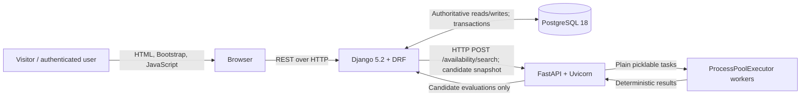

# System Architecture

## 1. Purpose and design principles

This design translates the approved Phase 1 MVP into a small local-first system. It keeps facility and booking truth in one Django/PostgreSQL application, uses FastAPI only for read-only availability candidate evaluation, and avoids infrastructure that is not needed for the academic MVP.

The design follows these principles:

- A facility is represented once; sports and physical bookable resources are related records.
- A booking reserves a physical resource, regardless of which supported sport the user selected.
- Search results are advisory. Only the final Django/PostgreSQL transaction can confirm a booking.
- Verified local facts remain distinct from clearly labeled synthetic demo data.
- The same pure candidate rule is used by serial and parallel evaluation paths.
- Failures at service boundaries remain explicit; missing data or failed requests never imply availability.

## 2. Logical components

### Browser UI

The browser presents HTML, Bootstrap styling, JavaScript interactions, facility discovery, facility profiles, and playable-time search. Leaflet may display verified coordinates with required OpenStreetMap attribution. It must not place fabricated or generic Naval-center pins.

The browser calls Django REST endpoints. It never connects to PostgreSQL, chooses an authoritative rate, decides that an availability-service timeout means “available,” or writes directly to FastAPI.

### Django 5.2 LTS + Django REST Framework

Django is the system of record and application boundary for:

- Public catalog and search API responses.
- Session authentication, booking ownership, and administrative authorization.
- Facility, sport, resource, schedule, closure, rate, and booking validation.
- Decimal price calculation and immutable price snapshots.
- Booking creation/cancellation and PostgreSQL transaction management.
- Final revalidation of schedule, operating hours, closures, capacity, and booking conflicts.
- Calling FastAPI for read-only candidate evaluation and translating failures into explicit API outcomes.

Django serves the browser UI/static assets for the simplest MVP deployment. Django must revalidate an availability candidate independently during booking creation; a FastAPI response is not a reservation or lock.

### PostgreSQL 18

PostgreSQL stores the authoritative facility, resource, schedule, closure, rate, user-reference, and booking records. Django is the only service permitted to write booking state. Use Django's PostgreSQL backend with Psycopg 3. Store timezone-aware instants in PostgreSQL; Django presents and validates schedules in `Asia/Manila`.

The proposed default conflict strategy is to lock the existing resource row inside the final booking transaction, then recheck for overlapping confirmed bookings before insertion. Every booking write path must follow this protocol. A database exclusion constraint may be added as defense in depth after its schema/extension and privilege implications are reviewed in Phase 3.

### FastAPI Availability Service + Uvicorn

FastAPI exposes `POST /availability/search`. It accepts a bounded, validated, plain-data snapshot of candidate slots and the relevant operating/sport schedules, closures, and confirmed-booking intervals. It returns per-candidate explanations such as `available`, `unsupported_sport`, `outside_hours`, `unscheduled`, `closed`, or `booked`.

The service is read-only and stateless with respect to the booking database. It does not receive database connections or ORM objects; it does not create, confirm, cancel, or price bookings. It has no separate authoritative booking store. Candidate data should omit user names and other personal data not needed to test an interval.

Uvicorn runs the FastAPI ASGI application as a separately configurable process. The parallel evaluator uses `ProcessPoolExecutor` within the availability service when selected by the implementation; workers are pure functions over picklable values and do not write shared state.

## 3. Communication and trust boundaries

1. The browser sends public discovery/playability requests or authenticated booking requests to Django.
2. Django reads the authoritative catalog and schedule records from PostgreSQL.
3. For candidate search, Django assembles only the necessary serializable data and calls FastAPI over HTTP. The evaluator does not query the database itself.
4. FastAPI returns candidate outcomes. Django may return them as advisory search results.
5. To book, Django opens a PostgreSQL transaction, locks the resource, re-reads current schedule/closure/confirmed-booking state, calculates the authoritative rate snapshot, and writes the booking only if all checks pass.
6. FastAPI downtime can make candidate search unavailable, but it cannot grant a booking. Django's final transaction remains the conflict authority.

The FastAPI base URL and service-to-service authentication/configuration belong in process environment variables. Bind to loopback for a same-machine demonstration. If a LAN demonstration is later approved, explicitly configure the service's listen address, firewall, authenticated service-to-service traffic, and network protections; do not expose an unauthenticated internal API broadly.

## 4. Local execution versus distributed deployment

The expected MVP runs Django and FastAPI as separate processes on one Windows laptop, with PostgreSQL on that machine. This proves separate service processes and HTTP communication over the local host. The services still share the same laptop, operating system, and hardware; this is not multi-machine or cloud deployment.

If configured and tested across two laptops on a LAN, the HTTP boundary can demonstrate multi-machine LAN communication. That claim requires an actual successful test and depends on network/firewall configuration. No cloud hosting, Docker, Redis, or Kubernetes is part of this design.

## 5. Availability and booking consistency

Availability computation can be stale immediately after it is calculated. The returned status is explicitly a candidate result, not a hold. Django's final transaction repeats the business checks against current PostgreSQL data. A resource-level lock serializes concurrent writers, including the case where no conflicting booking row exists yet. The safe protocol and lock ordering are specified in [workflows.md](workflows.md) and [database-design.md](database-design.md).

## 6. Deployment boundary for the MVP

The deployment consists only of:

- Browser UI served by Django.
- Django/DRF application process.
- FastAPI/Uvicorn process.
- Existing local PostgreSQL 18 server.

The Python virtual environment and lock file provide reproducible dependencies. Secrets and machine-specific URLs are environment configuration, not committed values. pgAdmin is an optional operator tool, not an application component.
