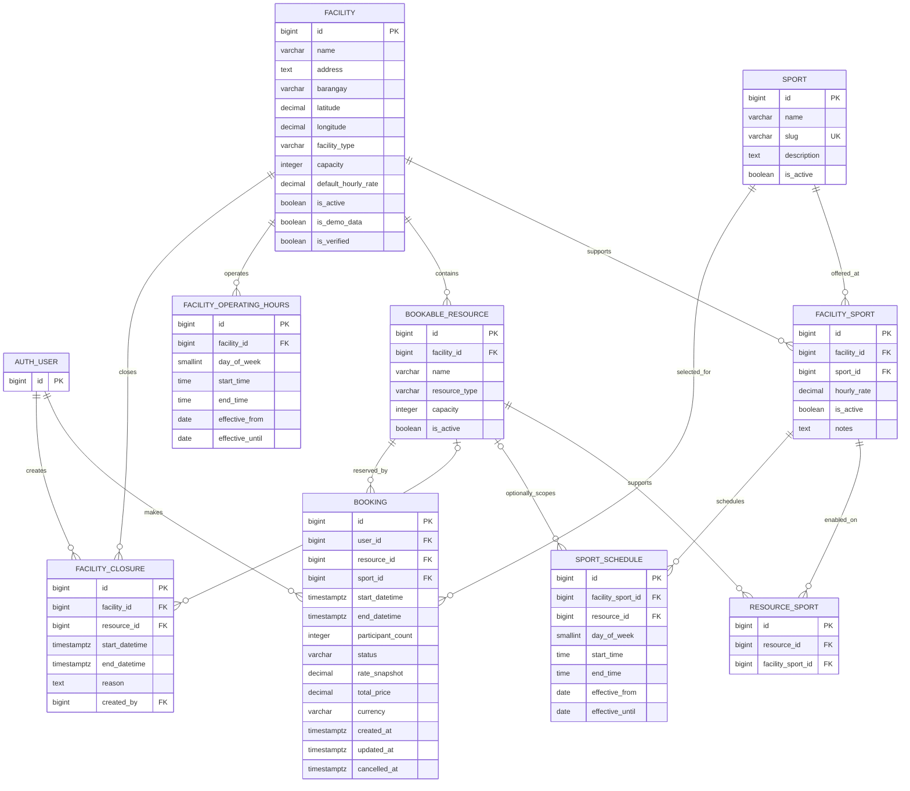

# Database Design

## 1. Design goals

- Store facilities, supported sports, and physical resources separately.
- Make the physical resource the booking conflict identity across sports.
- Support weekly schedules with effective date bounds and date/time closures.
- Preserve booking history, participant counts, and immutable Decimal price snapshots.
- Keep synthetic provenance explicit and real-world coordinates nullable until verified.
- Let Django/PostgreSQL alone authorize and write bookings.

The ERD is logical design, not an applied schema. No database or migration is created in Phase 2.

## 2. Logical entity relationship diagram

`RESOURCE_SPORT` is a normalized join table ensuring a resource is only scheduled/booked for a sport supported by its facility. `FACILITY_OPERATING_HOURS` is added because recurring venue hours must not be conflated with a sport-specific schedule. `FACILITY.default_hourly_rate` is added to support the approved fallback rate.

## 3. Table design

All `id` values are Django-managed primary keys. `created_at`/`updated_at` timestamps should be timezone-aware where present. Required/optional fields and `on_delete` behavior are finalized in Phase 3 model design; historical booking/resource/sport relations should not be cascade-deleted.

### `Sport`

| Column | Type | Constraints / purpose |
|---|---|---|
| `id` | Big integer PK | Django primary key. |
| `name` | Varchar | Required display name. |
| `slug` | Varchar | Required, unique, URL-safe stable identifier. |
| `description` | Text, nullable | Optional public description. |
| `is_active` | Boolean | Inactive sports are not offered to public search or new booking. |
| timestamps | Timestamptz | Audit metadata if useful. |

### `Facility`

| Column | Type | Constraints / purpose |
|---|---|---|
| `id` | Big integer PK | Facility identity, not duplicated per sport. |
| `name` | Varchar | Required; synthetic values must be visibly labeled. |
| `address`, `barangay` | Text/Varchar, nullable | Populate as verified facts or clearly synthetic values. |
| `latitude`, `longitude` | Decimal or double precision, nullable | Store only sourced values; never treat blank/unknown values as a map point. Decimal precision should be chosen for coordinates in Phase 3. |
| `facility_type` | Varchar/choice | For example public/private/other only when known; do not infer. |
| `capacity` | Positive integer, nullable | Facility-level limit where known; a resource-specific capacity may be more precise. |
| `default_hourly_rate` | `numeric(10,2)`, nullable | PHP flat-slot default fallback; use Decimal. |
| `is_active` | Boolean | Deactivation prevents new public bookings; retain historical relations. |
| `is_demo_data` | Boolean | Identifies fictional demo record; default false. |
| `is_verified` | Boolean | False until documented verification; synthetic rows remain false. |
| `data_source`, `verified_by`, `verification_date` | Text/user/date, nullable | Provenance; required by policy for verified local facts. |

Recommended checks: latitude/longitude both null or both present and in range; non-negative capacity; non-negative default rate. Application policy also requires a credible source before setting `is_verified=true`.

### `FacilitySport`

| Column | Type | Constraints / purpose |
|---|---|---|
| `id` | Big integer PK | Association identity. |
| `facility_id` | FK to Facility | Required. |
| `sport_id` | FK to Sport | Required. |
| `hourly_rate` | `numeric(10,2)`, nullable | Sport-specific PHP flat-slot rate; if null, use facility default. |
| `is_active` | Boolean | Deactivate offering without deleting history. |
| `notes` | Text, nullable | Non-authoritative notes; avoid unverified public claims. |
| uniqueness | Unique `(facility_id, sport_id)` | Prevent duplicate support associations. |

### `BookableResource`

| Column | Type | Constraints / purpose |
|---|---|---|
| `id` | Big integer PK | Physical bookable space identity. |
| `facility_id` | FK to Facility | Required. |
| `name` | Varchar | Facility-local resource label. |
| `resource_type` | Varchar/choice | For example court, hall, or other confirmed type. |
| `capacity` | Positive integer, nullable | Prefer resource capacity when known; may fall back to facility capacity. |
| `is_active` | Boolean | Inactive resource cannot receive new bookings. |
| uniqueness | Unique `(facility_id, name)` | Avoid duplicate resource labels in one facility. |

### `ResourceSport`

Join a `BookableResource` to a `FacilitySport` association. Enforce unique `(resource_id, facility_sport_id)`. The resource's facility must match the Facility referenced by its FacilitySport; validate this consistently in the service layer (or use an explicitly designed database constraint if added later). This join prevents an individual sport being treated as playable on a resource that does not support it.

### `FacilityOperatingHours`

Weekly facility-level open intervals: `facility_id`, `day_of_week` (Monday=0 through Sunday=6), `start_time`, `end_time`, optional inclusive `effective_from`/`effective_until`. Require `start_time < end_time`, no overnight interval, valid weekday, and ordered effective dates. Multiple rows may represent multiple open blocks on one day.

### `SportSchedule`

Fields requested: `facility_sport_id`, optional `resource_id`, weekday, start/end local times, optional effective date bounds. `resource_id=NULL` means the association-level schedule applies to all eligible resources; a resource-specific row scopes a schedule to that physical resource and takes precedence for that resource/day/effective period. Do not merge a resource-specific override with the association-wide schedule in a way that silently opens an intentionally closed interval. Overlapping effective schedule definitions should be rejected or explicitly resolved by application validation.

Require `start_time < end_time`; schedules do not cross midnight. Weekly recurrence is evaluated in `Asia/Manila`; effective dates are inclusive calendar dates in that timezone. A candidate hour must fit entirely inside an operating-hours interval and an effective sport schedule interval.

### `FacilityClosure`

Fields requested: `facility_id`, optional `resource_id`, timezone-aware `start_datetime`, `end_datetime`, `reason`, `created_by`. A null resource means the closure applies facility-wide; a resource-specific closure blocks only that resource. Require `start_datetime < end_datetime`, ensure a scoped resource belongs to the same facility, preserve the creator/audit history, and evaluate overlap with half-open intervals. Closures override schedules.

### `Booking`

| Column | Type | Constraints / purpose |
|---|---|---|
| `id` | Big integer PK | Booking history identity. |
| `user_id` | FK to Django auth user | Required; never expose another user's booking. |
| `resource_id` | FK to BookableResource | Required conflict identity. |
| `sport_id` | FK to Sport | Required; validate resource/sport eligibility. |
| `start_datetime`, `end_datetime` | Timestamptz | A one-hour interval in Asia/Manila; stored as timezone-aware instants. |
| `participant_count` | Positive integer | At least one; do not exceed known resource/facility capacity. |
| `status` | Choice | Only `CONFIRMED` and `CANCELLED` in MVP. |
| `rate_snapshot`, `total_price` | `numeric(10,2)` | Immutable Decimal PHP values captured at booking time. For a one-hour flat slot, total equals rate snapshot. |
| `currency` | Char(3) | `PHP` for the approved local-rate convention. |
| `created_at`, `updated_at` | Timestamptz | Audit timestamps. |
| `cancelled_at` | Timestamptz, nullable | Retain cancellation event while preserving booking row. |

Do not cascade-delete users, resources, or sports in a way that destroys booking history. Prefer protected references or soft deactivation for catalog entities.

## 4. Constraints and validation

Database constraints should cover rules expressible on a single row: positive participant count, positive interval duration, one-hour duration where supported by an expression/check, non-negative rates/capacity, valid status choices (plus model validation), and unique associations. Cross-row rules such as resource belongs to the booking's facility/sport, schedule applicability, and closure impact require transactional application validation unless additional schema constraints are deliberately designed.

All input datetimes are interpreted as local `Asia/Manila` values with explicit validation, then stored as timezone-aware instants. Reject nonexistent/ambiguous local instants if the timezone ever has such transitions; do not silently reinterpret invalid input. The agreed MVP does not allow cross-midnight slots.

## 5. Concurrency and race-condition strategy

### Primary MVP guard: lock the resource row

For booking creation:

1. Enter `transaction.atomic()`.
2. Load and `select_for_update()` the target existing `BookableResource`.
3. Re-read applicable schedule, closures, capacity, and `CONFIRMED` bookings after acquiring the lock.
4. Query conflict using `existing.start_datetime < requested.end_datetime` and `existing.end_datetime > requested.start_datetime`.
5. Insert the booking only if all checks still pass; otherwise return conflict and commit no booking.

Locking the resource row serializes competing booking attempts even when there is no existing booking row to lock. All booking writes and any admin actions affecting bookings must use a consistent lock protocol; when locking several resources, sort by primary key first. PostgreSQL's normal `READ COMMITTED` behavior ensures a subsequent query after a waited-on lock sees committed changes.

`select_for_update()` is effective on PostgreSQL but not a meaningful SQLite concurrency guarantee. Race-condition tests must use PostgreSQL. Do not run process-pool workers or FastAPI as booking writers.

### Optional defense in depth

A PostgreSQL exclusion constraint over `(resource_id, tstzrange(start_datetime, end_datetime, '[)'))` for `status='CONFIRMED'` can reject overlap independently of application code. A GiST exclusion combining scalar resource ID with a range may require `btree_gist` and extension privileges. Evaluate that choice with the instructor/database owner before migrations. If implemented, handle the database integrity exception and return a clear conflict; keep resource locking/rechecks for schedule/closure policy and clean application responses.

Do not claim the lock design is safe if any booking writer can bypass it. The selected guard and all supported write paths must be covered by integration/concurrency tests before release.
